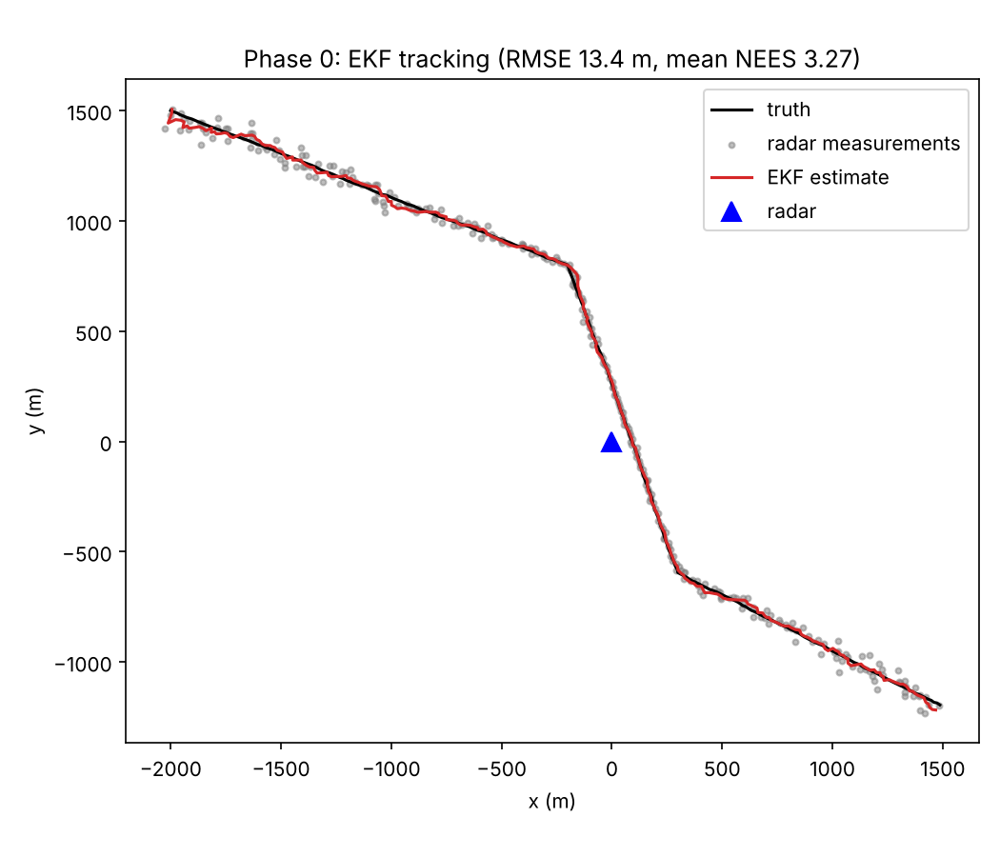
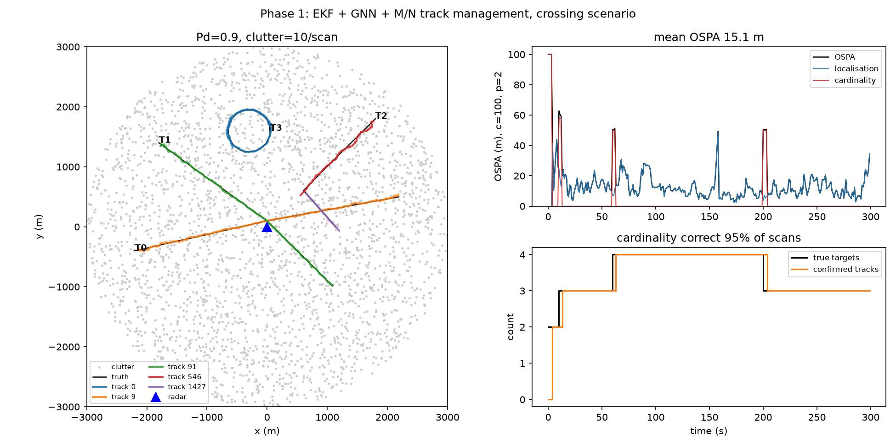

# SkyShield-Sim

Software-only counter-UAS sensor network simulator: **detect, track, survive**.

Simulates drones approaching a protected site, a distributed sensor network observing them, and a fusion center tracking them. A later phase couples a jammable backhaul link to the tracker to quantify how communications attacks degrade situational awareness.

> Simulation and defensive analysis only.

## Status

**Phase 0:** scenario generator, noisy radar model (range/bearing, Pd, clutter), and an Extended Kalman Filter tracking a single drone.



**Phase 1 (tracking core, in progress):** multi-target tracking in clutter.

- Ground truth with target births and deaths (4 drones, two crossing over the radar, one loitering)
- Global Nearest Neighbour association: chi-square gating plus optimal (Hungarian) assignment
- Track management: M/N confirmation and deletion after consecutive misses
- OSPA metric, split into localisation and cardinality parts



Monte Carlo results (20 runs per point, OSPA c = 100 m, p = 2):


OSPA stays around 15-17 m from 0 to 40 false alarms per scan: M/N confirmation keeps clutter out of the confirmed track set. Detection probability matters much more. Below Pd = 0.8, tracks are confirmed late and dropped early, so the cardinality term dominates.

## Quickstart

```bash
pip install -e .[dev]
pytest
python experiments/phase0_single_target.py
python experiments/phase1_multi_target.py   # ~3 min (Monte Carlo sweeps)
```

See `CLAUDE.md` for architecture, decisions and the roadmap.
