# SkyShield-Sim

Software-only counter-UAS sensor network simulator: **detect, track, survive**.

Drones fly through a protected area. Three radars detect them, with misses and clutter, and send each scan over a jammable radio backhaul to a fusion centre that tracks them. The question this project answers: **how much jamming does it take to blind the network, and how much do frequency hopping and DSSS buy?**

> Simulation and defensive analysis only.


*A 50 dBm spot jammer comes on at 100 s. With a plain fixed-channel backhaul (left), every radar report is lost (red) and the track picture is gone within a few seconds. With frequency hopping (right), the same jammer does nothing. Both panels see identical drones, detections and clutter.*

**Headline result:** spread spectrum buys about 18 dB of jammer power before tracking degrades. Tracking error doubles at 40 dBm jammer EIRP on a plain link, and at 56-58 dBm on FH or DSSS. Along the way: 30 % random packet loss costs the tracker only 2.5 m of accuracy, and *which* packets are lost matters as much as how many.

- **Technical write-up:** [docs/writeup.md](docs/writeup.md) covers models, validation, results and limitations.
- **Interactive dashboard:** `streamlit run streamlit_app.py` lets you pick a jammer and watch the closed loop (see [Dashboard](#dashboard)).
- Everything is written from scratch: the EKF, GNN/Hungarian association, track management, OSPA, the CNN RF detector, and the link and jammer models. The suite has 110 tests, and every experiment is seeded and reproducible.

## Results by phase

**Phase 0:** scenario generator, noisy radar model (range/bearing, Pd, clutter), and an Extended Kalman Filter tracking a single drone.


**Phase 1 (tracking core):** multi-target tracking in clutter.

- Ground truth with target births and deaths (4 drones, two crossing over the radar, one loitering)
- Global Nearest Neighbour association: chi-square gating plus optimal (Hungarian) assignment
- Track management: M/N confirmation and deletion after consecutive misses
- OSPA metric, split into localisation and cardinality parts


Monte Carlo results (20 runs per point, OSPA c = 100 m, p = 2):

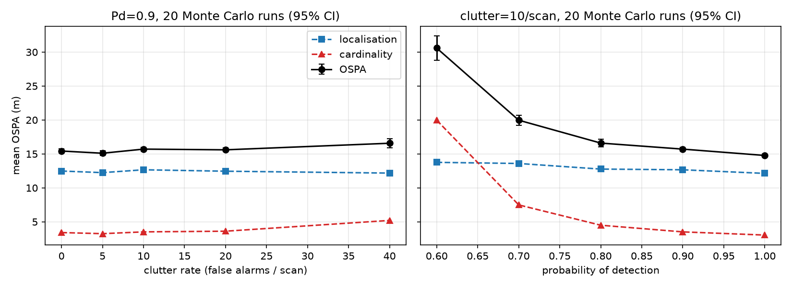

OSPA stays around 15-17 m from 0 to 40 false alarms per scan: M/N confirmation keeps clutter out of the confirmed track set. Detection probability matters much more. Below Pd = 0.8, tracks are confirmed late and dropped early, so the cardinality term dominates.

**Phase 2 (RF detection):** a CNN that detects drone control and video links in synthetic RF spectrograms, plus a passive direction-finding sensor driven by the detector's measured performance.

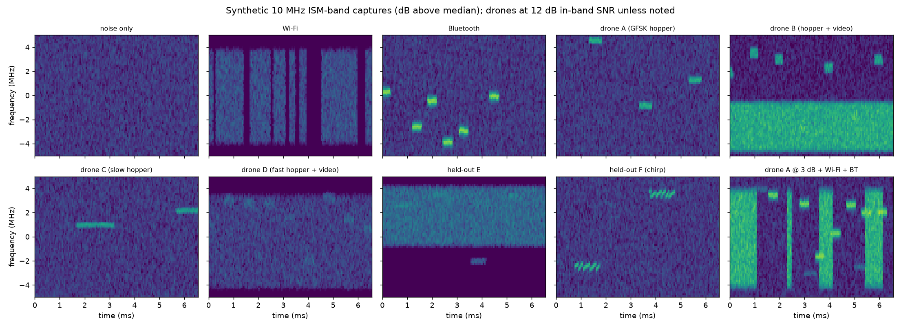

The CNN is trained on drone models A-D in a mixed environment (noise, Wi-Fi, Bluetooth). Its threshold is fixed once at Pfa = 1 % and then tested unchanged in each condition. SNR is in-band, so it maps directly to a link budget.

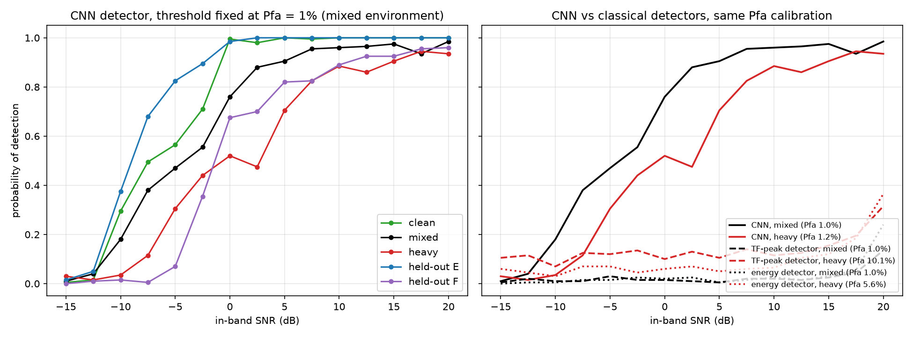

| Condition | SNR for Pd = 0.9 | AUC at 0 dB |
|---|---|---|
| clean (no interferers) | -0.8 dB | 1.000 |
| mixed (as in training) | 4.5 dB | 0.962 |
| heavy (Wi-Fi + Bluetooth always on) | 14.7 dB | 0.820 |
| held-out E (new GFSK model, has video) | -2.4 dB | 0.999 |
| held-out F (unseen chirp modulation) | 10.7 dB | 0.948 |

- Interference is the main cost: about 5 dB from clean to mixed, and another 10 dB to heavy.
- Classical detectors fail once interference is present. A wideband energy detector and a time-frequency peak detector, calibrated the same way, have AUC 0.63 and 0.60 at 0 dB in the mixed environment. Their false-alarm rate rises to 6-10 % in heavy interference; the CNN's stays at 1.2 %.
- Generalisation depends on what the new drone shares with training. E is detected easily, but mostly through its wideband video link. F has no video and an unseen modulation, and needs about 6 dB more SNR than the training models.

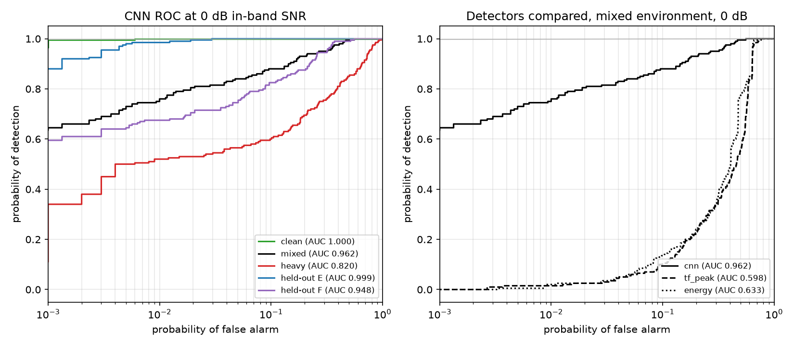

The measured Pd(SNR) curve drives an RF direction-finding sensor model: link budget, then in-band SNR, then Pd, then a noisy bearing. For a 20 dBm control link, Pd stays above 0.9 beyond 6 km in free space, out to about 2.8 km with path-loss exponent 2.5, and only to about 0.7 km with exponent 3. Path loss, not the detector, sets the range.

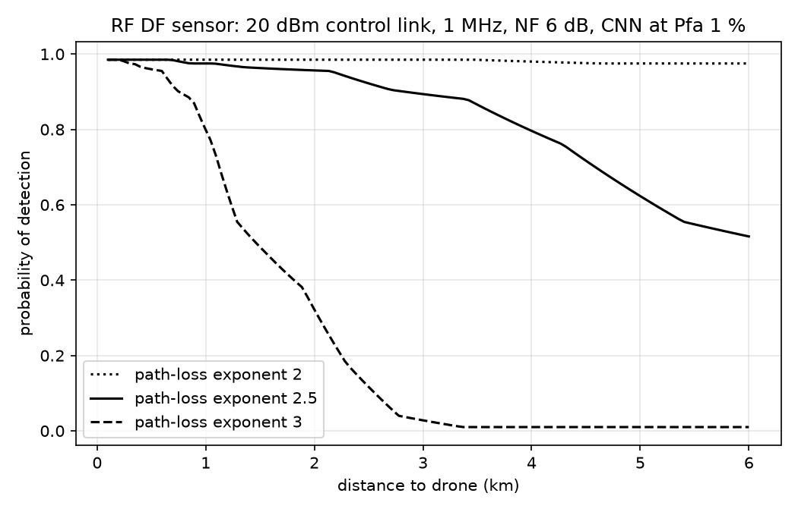

**Phase 3 (comms layer):** the sensor-to-fusion backhaul, modelled from link budget to packet delivery. It is built so that Phase 4 can push sensor reports through it.

- 64 x 1 MHz band, 1 Mbit/s BPSK. Three waveforms with the same bit rate and total bandwidth: **plain** (one fixed channel), **slow FH** (new channel per packet attempt) and **DSSS** (Gp = 64, 18.1 dB).
- Four jammer shapes with equal total power: spot, partial-band (fraction rho), sweep and barrage.
- Error chain: SINR, then BER, then BCH(63,45) codeword errors, then packet error rate, then stop-and-wait ARQ, giving packet delivery ratio (PDR) and latency. A `DelayLine` hands delivered reports to the fusion centre at their arrival time.
- The analytic models are checked against baseband Monte Carlo. This includes a chip-level DSSS receiver against a CW tone, which tests the "despread jammer is Gaussian noise of power J/Gp" assumption. Every Monte Carlo point falls inside its 95 % interval.

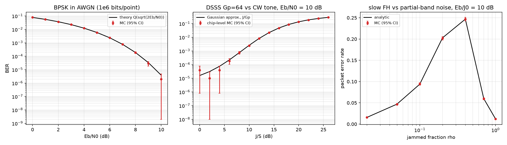

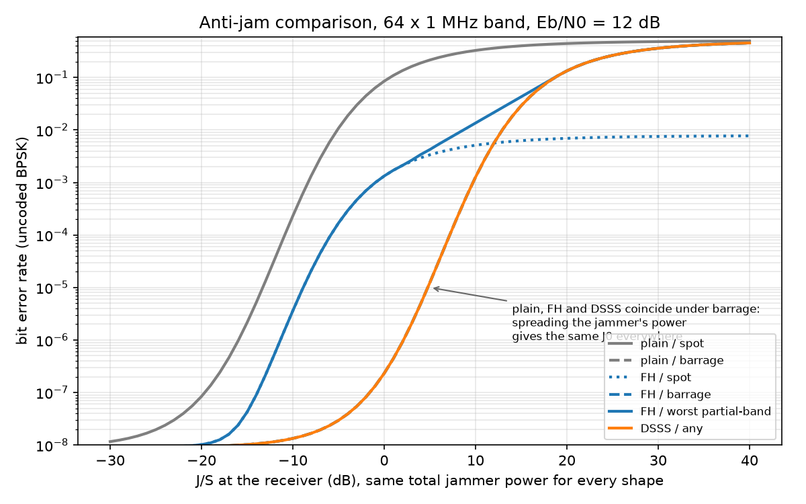

- **Against a barrage jammer, spread spectrum buys nothing.** Spreading the same power over the whole band gives every waveform the same J0, so the three curves coincide.
- **Spread spectrum pays off against concentrated jammers.** A spot jammer on a plain link's channel needs 18 dB less power than a barrage jammer to do the same damage, and that 18 dB is exactly DSSS's processing gain.
- **Uncoded FH is vulnerable to partial-band jamming.** The jammer's best choice is to jam a fraction rho* ≈ 0.7 / (Eb/J0) of the band (textbook result, reproduced below). That leaves uncoded FH worse than DSSS until J/S is high. Coding plus ARQ (retrying on a fresh hop) closes the gap at packet level.

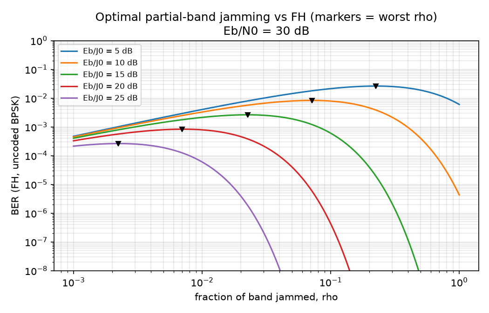

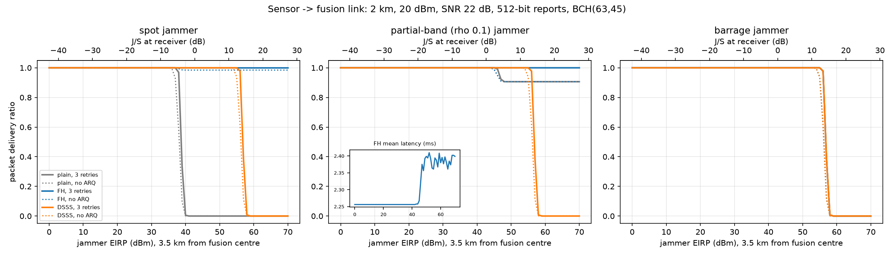

At link level, a 2 km mast-to-mast link (20 dBm, SNR 22 dB) faces a ground jammer 3.5 km from the fusion centre. PDR first falls below 0.9 at:

| Jammer | plain | FH | DSSS |
|---|---|---|---|
| spot (on plain's channel) | 39 dBm | never (up to 70 dBm) | 57 dBm |
| partial-band, rho = 0.1 | plateaus at 0.90 | never | 57 dBm |
| barrage | 57 dBm | 57 dBm | 57 dBm |

Retries cannot rescue a plain link whose channel is jammed, because every retry lands on the same channel. FH retries hop away from the jammer, so FH never drops below 0.9 here; the cost is about 0.15 ms of added mean latency.

**Phase 4 (closed loop):** jamming leads to backhaul packet loss, which leads to tracking error. This is the project's headline result.

Three radars report to a fusion centre over backhaul links 1.1, 2.3 and 3.2 km long. Each scan travels as one report packet, and clutter makes it longer. Each packet goes through `BackhaulLink.send` (jamming, BCH coding, ARQ) and then a delay buffer. The fusion centre fuses whatever has arrived by its deadline, one sensor at a time, and runs track management once per step. A ground jammer 3.5 km away attacks the fusion centre's receiver.

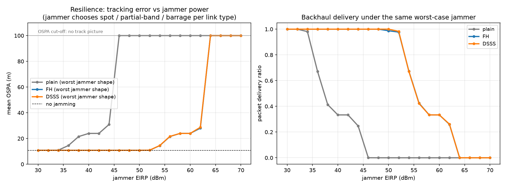

| Backhaul | OSPA starts rising | Track picture lost | Jammer EIRP for 2x OSPA |
|---|---|---|---|
| plain | 36 dBm | 46 dBm | 40 dBm |
| FH | 54 dBm | 64 dBm | 58 dBm |
| DSSS | 54 dBm | 64 dBm | 56 dBm |

- Each curve is against the worst jammer shape for that link: spot for plain, barrage for FH, and for DSSS every shape is equivalent. On that basis, spread spectrum buys about 18 dB of jammer power before the track picture degrades, which is the processing gain again, now measured in tracking error.
- Degradation is graceful because the links fail in order of length. The longest link drops first and OSPA rises from about 11 m to about 15 m. With only the nearest radar left, OSPA is about 24-30 m. When the last link goes, there is no track picture (OSPA = 100 m cut-off).

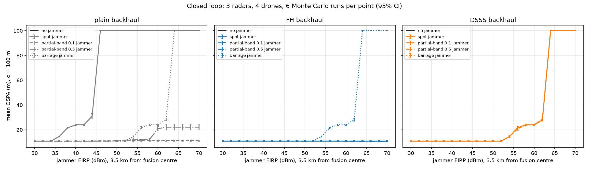

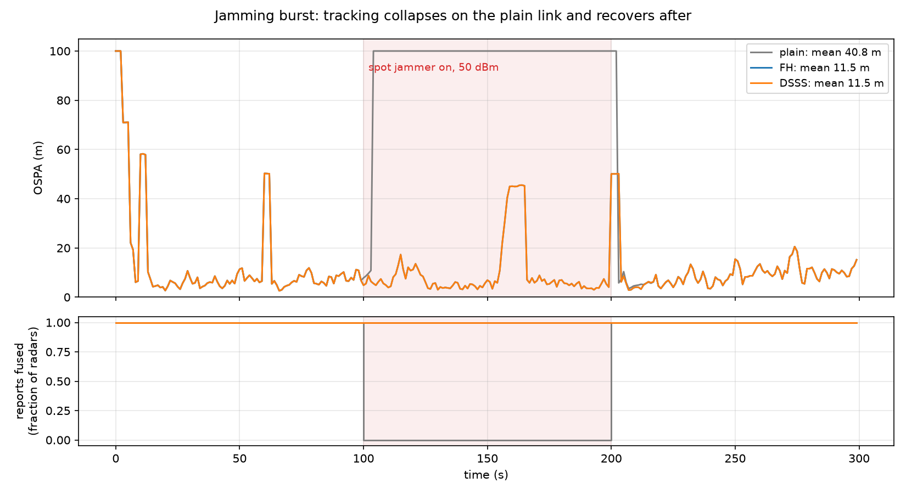

A 50 dBm spot jammer switched on from 100 to 200 s blinds the plain-link network within a few scans. Once the jammer stops, tracks re-confirm in about 4 s (the 4-of-5 confirmation rule). The FH and DSSS networks don't notice it.


- **How much delivery the tracker needs:** with independent random loss, the tracker tolerates PDR down to about 0.7 (OSPA 13 m vs 11 m). It degrades steeply below 0.5 and is blind below about 0.15.
- **PDR alone doesn't predict tracking error.** Jamming losses sit below the i.i.d. curve. At PDR 0.33, jamming that removes whole sensors gives about 24 m, while random loss spread over all sensors gives about 50 m. A sensor that keeps reporting every scan keeps its tracks alive; random loss starves all of them.
- **Latency doesn't matter here.** ARQ delays are about 2 ms against a 1 s scan and 0.2 s fusion deadline, so no report ever went stale. Loss, not delay, drives the degradation.

## Dashboard

```bash
pip install -e .[dashboard]
streamlit run streamlit_app.py
```

In the sidebar you pick the jammer shape, power and on-time, the radar Pd and the clutter rate. The app runs the closed loop for plain, FH and DSSS backhaul plus an unjammed reference, about 15 s for all four. It then shows:

- KPI cards: OSPA and fraction of reports fused while jammed, for each link type
- An animated map replay: drones, detections fused (blue) or lost on the backhaul (red), confirmed tracks with 2σ ellipses, and the state of each link
- OSPA and delivery over time for all link types
- The backhaul link budget per radar: length, SNR and J/S

A second view shows the precomputed Monte Carlo study from Phase 4.

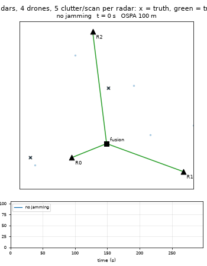

## Quickstart

```bash
pip install -e .[dev,ml,dashboard]   # ml = PyTorch (Phase 2), dashboard = Streamlit + Plotly
pytest
python experiments/phase0_single_target.py
python experiments/phase1_multi_target.py   # ~3 min (Monte Carlo sweeps)
python experiments/phase2_rf_detection.py   # ~10-20 min on CPU
python experiments/phase3_comms.py          # ~40 s
python experiments/phase4_closed_loop.py    # ~9 min (process pool)
python experiments/phase5_replay_gifs.py    # ~1 min, README GIFs
streamlit run streamlit_app.py
```

## Limitations

- The closed loop is radar-only. The RF direction-finding sensor is modelled but not yet fused.
- The constant-velocity EKF re-initiates a track after a sharp turn. IMM is the planned fix.
- RF data is synthetic, so detector SNR thresholds are properties of the simulator, not of real hardware.
- 2D geometry, log-distance propagation, a static jammer.

See `CLAUDE.md` for architecture, decisions and the roadmap.
