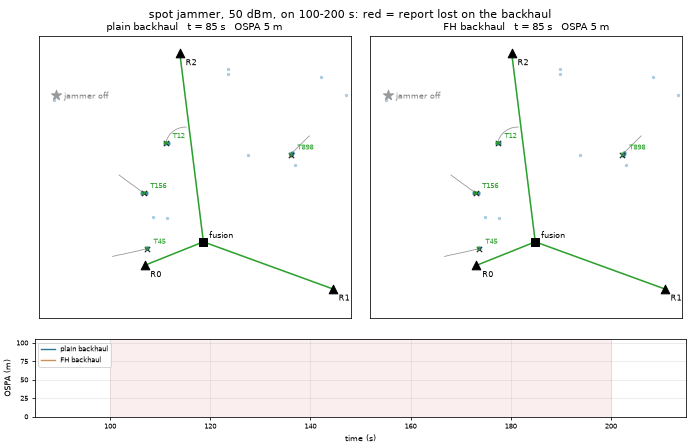
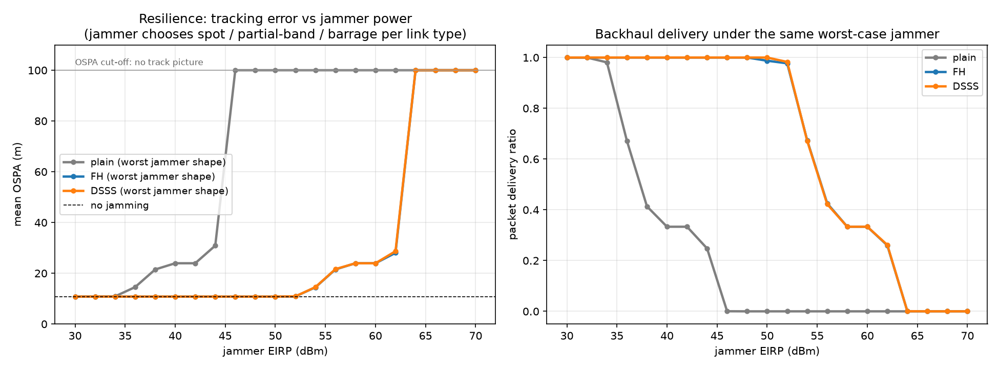
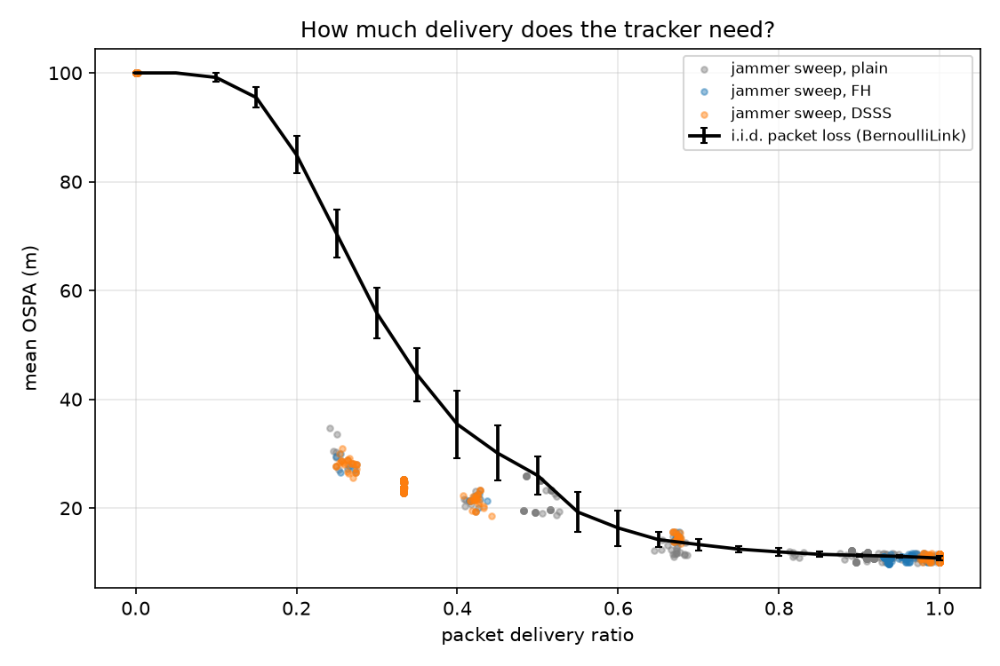
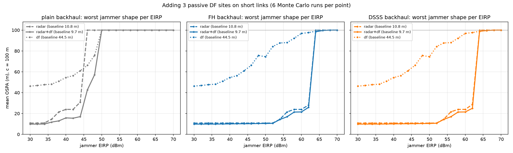

# How much jamming does it take to blind a counter-UAS sensor network?

*SkyShield-Sim technical write-up. Simulation and defensive analysis only.*

## Summary

Counter-UAS studies usually treat sensors, trackers and communication links as separate problems. A drone detector is scored by Pd and Pfa, a tracker by its error on perfect measurements, and a radio link by its bit error rate. A real network is a chain, though. A jammer that never touches a sensor can still blind the system by stopping sensor reports from reaching the fusion centre.

SkyShield-Sim models that chain from end to end. Drones fly through a protected area. Three radars detect them, with misses and clutter. Each scan travels to the fusion centre as a packet over a jammable radio backhaul, and a multi-target tracker fuses whatever arrives. Tracking error (OSPA) is the final measure. The main findings:

1. **Spread spectrum buys about 18 dB of jammer power, measured in tracking error.** With a plain fixed-channel backhaul, tracking error doubles at 40 dBm jammer EIRP. With frequency hopping or DSSS it takes 56-58 dBm. The difference matches the 18 dB processing gain of the 64-channel waveforms, because the jammer picks its most damaging shape for each link type.
2. **The tracker tolerates far more loss than the radio link would suggest.** With random loss, delivering 70 % of reports costs almost nothing (OSPA 13.3 m against 10.8 m). Tracking collapses only below about 30 % delivery.
3. **Delivery ratio alone does not predict tracking error.** At the same 33 % delivery, losing whole sensors (what a jammer does to the longest links) gives about 24 m OSPA. Random loss spread over every sensor gives about 50 m. Loss structure matters as much as loss rate.
4. **Latency was never the problem.** ARQ retries cost milliseconds against a 1 s scan. In 1656 Monte Carlo runs, no report missed its fusion deadline.
5. **Passive RF direction finding on short links is a useful fallback, if radar stays in charge.** Three DF sites near the fusion centre let the network tolerate 4-6 dB more jammer power before tracking error doubles, and keep every drone tracked through a burst that blinds the radar backhaul. This only works because a radar that is heard overrides bearing-only evidence: when bearings counted everywhere, DF made tracking worse. Under barrage jamming the DF receivers themselves are desensitised, about 4 dB before their own links fail.

The rest of this document describes the models, how they were validated, and the results.



## 1. System model

All geometry is 2D. Time advances in fixed 1 s steps, and the comms layer uses a delay buffer, so sub-step latency is still modelled. Every random draw is seeded, and each experiment is a script in `experiments/` that writes its figures and metrics to `results/`.

### 1.1 Scenario and sensors

- **Targets.** Four drones with births and deaths over 300 s: two crossing the area, one entering late (alive from 60 s to 200 s) and one loitering. They follow a constant-velocity model with random acceleration (σ = 0.5 m/s²).
- **Radar.** Measures range and bearing (σ_r = 5 m, σ_b = 1°), with Pd = 0.9 and 3 km maximum range. Clutter is Poisson (5 false alarms per scan in Phase 4), placed uniformly over the coverage disc.
- **RF direction finding.** This model is passive. The emitter's EIRP goes through log-distance path loss to give in-band SNR. That SNR sets Pd from the CNN detector's measured curve (section 1.3), and bearing noise scales as 1/√SNR. It is fully modelled and tested, but not yet fused in the closed loop (section 5).

### 1.2 Tracker

The tracker is written from scratch and tested.

- **Filter.** One extended Kalman filter per track: constant-velocity state, range-bearing measurements.
- **Association.** Global nearest neighbour. A chi-square gate (99 %) limits candidates, and the Hungarian algorithm minimises total cost (d² + ln|S|), with one "missed detection" column per track. Confirmed tracks are associated first and tentative tracks get what is left, so a new track cannot steal an established track's measurement.
- **Track management.** Every unused measurement starts a tentative track. A track is confirmed after 4 hits in 5 scans and deleted after 5 consecutive misses or once its position uncertainty exceeds 300 m. 4/5 was chosen over 3/4 by measurement. At 20 clutter points per scan with no targets, 3/4 confirmed about 0.17 false tracks per scan and 4/5 confirmed none, with no OSPA cost on the test scenario.
- **Multi-sensor fusion.** Each fusion step runs `begin_step(t)`, then one `update()` per delivered report, then `end_step()`. A track counts as hit if any sensor updated it, so a target seen by one radar is not "missed" by the others.

**Metric.** OSPA (Schuhmacher et al., 2008) with c = 100 m and p = 2, split into localisation and cardinality parts. An OSPA of 100 m means there is no usable track picture.

### 1.3 RF drone detector

Synthetic complex-baseband captures are 6.55 ms long at 10 MS/s. They contain drone control links (GFSK or chirp frequency hoppers), wideband video, Wi-Fi bursts and Bluetooth hoppers. The detector is a four-block CNN on a 64 × 128 log spectrogram, normalised to the capture's median level so receiver gain drops out. It uses GroupNorm: with short training runs, BatchNorm's running statistics lagged the weights and eval-mode accuracy fell from 1.0 to 0.69. The detection threshold is set once at Pfa = 1 % and then held fixed in every test condition, so interference shows up honestly as lost Pd and extra false alarms.

### 1.4 Backhaul

- **Band and waveforms.** 64 channels, each 1 MHz wide, carrying 1 Mbit/s BPSK. Three waveforms share the same bit rate and total bandwidth: **plain** (one fixed channel), **slow FH** (a new channel for each packet attempt) and **DSSS** (processing gain Gp = 64, i.e. 18.1 dB).
- **Jammers.** Spot, partial-band (jamming a fraction ρ of the band), sweep and barrage. Each is described by a received power per channel, so all four have the same total power.
- **Error chain.** SINR gives the BPSK bit error rate, BCH(63,45) gives the codeword error rate, and that gives the packet error rate. Stop-and-wait ARQ allows up to 3 retries. The jammer's state holds for all retries of one packet, so retries help FH (it hops away) but not a plain link sitting on a jammed channel.
- **Links.** 20 dBm mast-to-mast links with path-loss exponent 2. The jammer is a ground emitter with exponent 2.5, 3.5 km from the fusion centre.

### 1.5 Closed loop

At each step, every radar scans and sends one report packet: a 96-bit header plus 48 bits per detection, so clutter makes reports longer and easier to lose. Each packet goes through `BackhaulLink.send` and into a delay line. The fusion centre runs 0.2 s after the scan and fuses every report that has arrived. A report that arrives later is stale and dropped; there is no out-of-sequence retrodiction.

Sensors and comms draw from separate random generators. Every link configuration in a Monte Carlo run therefore sees the same drones, detections and clutter. Comparisons between link types are paired, which removes most of the run-to-run variance from the differences.

**Geometry.** The three backhaul links are 1.1, 2.3 and 3.2 km long. They were made unequal on purpose. In a first version with equal links, all three failed at the same jammer power and the resilience curve collapsed into one step that hid any degradation.

## 2. Validation

| Model | Check | Result |
|---|---|---|
| EKF | Mean NEES over 100 runs, truth drawn from the filter's own motion model | between 3.5 and 4.5 (state dimension 4) |
| GNN | Hand-built case where greedy nearest-neighbour picks the wrong pair | Hungarian finds the global optimum |
| OSPA | Known cases: empty sets, pure cardinality error, shifted sets | exact values |
| BPSK BER | Monte Carlo, 400 000 bits per point | within ±4σ (binomial) |
| DSSS vs CW tone | Chip-level receiver Monte Carlo against the "despread jammer is Gaussian, J/Gp" model | within 25 % across J/S |
| FH vs partial-band noise | Monte Carlo packet error rate against the analytic hit/miss mixture | within 0.01 absolute |
| Partial-band optimum | Worst-case ρ* against the textbook ≈ 0.7/(Eb/J0) | reproduced (ρ* ≈ 0.071 at 10 dB) |
| Exact PDR | Enumerated jammer placements against sampled ones | within 0.02 |
| Closed loop | Unjammed radio links against a wired network | bit-identical OSPA |
| Refactors | Phase 1 OSPA before and after the tracker API change | bit-identical (15.09 m) |

The suite has 120 tests and runs with `pytest` in under a minute.

## 3. Results

### 3.1 Detection

| Condition | SNR for Pd = 0.9 | AUC at 0 dB |
|---|---|---|
| clean | -0.8 dB | 1.000 |
| mixed (training conditions) | 4.5 dB | 0.962 |
| heavy Wi-Fi + Bluetooth | 14.7 dB | 0.820 |
| held-out model E (new GFSK parameters) | -2.4 dB | 0.999 |
| held-out model F (unseen chirp modulation) | 10.7 dB | 0.948 |

- **Interference costs the most.** About 5 dB from clean to mixed, and another 10 dB to heavy.
- **Classical detectors fail under interference.** Energy and time-frequency peak detectors have AUC 0.63 and 0.60 at 0 dB in the mixed environment. In heavy interference their false-alarm rate rises to 6-10 %, while the CNN's stays at 1.2 %.
- **Path loss sets the detection range, not the detector.** For a 20 dBm control link, Pd stays above 0.9 beyond 6 km in free space, to 2.8 km with path-loss exponent 2.5, and to 0.7 km with exponent 3.

### 3.2 Tracking

On the crossing scenario, OSPA is about 15 m and the target count is right 95 % of the time. OSPA stays at 15-17 m from 0 to 40 clutter points per scan, because M/N confirmation keeps clutter out of the confirmed set. Detection probability matters far more: below Pd = 0.8, tracks confirm late and drop early, and the cardinality term dominates.

### 3.3 Backhaul

- **Barrage jamming neutralises spread spectrum.** With the jammer's power spread over the whole band, every waveform sees the same jammer noise density, and the three BER curves coincide.
- **Concentrated jamming is where spread spectrum pays.** A spot jammer on a plain link's channel needs 18 dB less power than barrage to do the same damage, and that 18 dB is exactly DSSS's processing gain.
- **Uncoded FH is vulnerable to partial-band jamming.** The worst-case ρ is about 0.7/(Eb/J0). BCH coding plus ARQ retries on fresh hops close the gap at packet level.

### 3.4 Closed loop



Each curve below is against the jammer shape that does the most damage to that link type: spot for plain, barrage for FH, and for DSSS every shape is equivalent. Points are means of 6 paired Monte Carlo runs.

| Backhaul | OSPA starts rising | Track picture lost | EIRP for 2× OSPA |
|---|---|---|---|
| plain | 36 dBm | 46 dBm | 40 dBm |
| FH | 54 dBm | 64 dBm | 58 dBm |
| DSSS | 54 dBm | 64 dBm | 56 dBm |

- **Degradation is graceful.** The links drop out longest first. OSPA goes from 10.8 m to about 15 m with two links, about 24-30 m with only the nearest radar, then hits the 100 m cut-off.
- **Bursts recover quickly.** A 50 dBm spot jammer switched on from 100 s to 200 s drives the plain network's OSPA to 96.4 m while it is on. FH and DSSS hold 9.6 m throughout. After the jammer stops, the plain network's tracks re-confirm in about 4 s, set by the 4-of-5 confirmation rule.



Random (i.i.d.) loss, with every radar delivering a given fraction of its reports:

| PDR | 1.0 | 0.9 | 0.7 | 0.5 | 0.3 | 0.15 | ≤ 0.1 |
|---|---|---|---|---|---|---|---|
| OSPA (m) | 10.8 | 11.3 | 13.3 | 26.0 | 55.8 | 95.5 | ≈ 100 |

The jammer sweeps sit *below* this curve. A jammer removes whole sensors, starting with the longest link, and the surviving sensors keep updating their tracks every scan. Random loss starves every track a little, so more tracks miss enough scans to be deleted.

The practical consequence for design: link-level PDR targets alone can mislead. What matters is whether each part of the coverage still has a sensor reporting reliably.

### 3.5 Passive RF direction finding in the loop



Three passive DF sites sit 0.7-0.8 km from the fusion centre, each on its own backhaul link with the same radio as the radars. They report bearings to the drones' 20 dBm control links. Detection uses the CNN's measured Pd(SNR) curve ("mixed" environment) and bearing noise scales as 1/√SNR. The drones' control links hop over the same 64 channels the backhaul uses, so the jammer's power on whichever channel a detection falls on adds to the DF noise floor.

**Tracking design.**
- **Update.** One-dimensional EKF bearing update with a per-report σ, and a 1-D gate in GNN.
- **Initiation.** A bearing can't start a track. New tracks come from crossings of leftover bearings from two sites, accepted only if a third site's bearing agrees (this suppresses ghost crossings). The fix is then refined by weighted Gauss-Newton, which also gives its covariance.
- **Radar authority.** Where a covering radar reported this step, a bearing-only hit doesn't count toward confirmation or keep a track alive, and no DF track is started there. Bearings still refine the estimate.
- **Paired runs.** DF draws from random generators spawned from the sensor and comms ones, so radar runs with and without DF see identical detections.

The authority rule was arrived at by measurement (unjammed, 3 paired runs; radar alone gives 10.7 m on the same runs). Each row adds to the one above:

| Track-management rule for bearings | OSPA | What the diagnostics showed |
|---|---|---|
| bearings count as hits everywhere (no new DF track where one already exists) | 17.6 m | false tracks confirmed by bearings that merely pass nearby |
| + bearings kept off radar-born tentative tracks | 13.9 m | a DF "ghost" track 1.9 km from any drone lived 33 steps on other drones' bearings |
| + DF-born tracks deleted after 3 steps of covering-radar misses | 12.3 m | a radar track outlived its drone because bearings kept hitting it |
| radar authority instead (adopted) | **9.5 m** | none: DF now improves on radar alone |

**Results** (6 paired Monte Carlo runs per point, worst jammer shape per link type):

| Backhaul | 2× OSPA, radar | 2× OSPA, radar + DF | Blind, radar | Blind, radar + DF |
|---|---|---|---|---|
| plain | 40 dBm | 46 dBm | 46 dBm | 50 dBm |
| FH | 58 dBm | 62 dBm | 64 dBm | 64 dBm |
| DSSS | 56 dBm | 62 dBm | 64 dBm | 64 dBm |

- **No jamming:** OSPA is 10.8 m with radar only, 9.7 m with DF added, and 44.5 m with DF alone. Bearings sharpen the radar tracks, but DF alone is only a coarse fallback (1-2° bearings at 1-2 km).
- **Burst:** in a 46 dBm spot-jammer burst on a plain backhaul, the radar network loses every report (OSPA 96 m, correct target count 4 % of the time). With DF it keeps 32 m and the correct count 100 % of the time.
- **Barrage jamming:** DF does not move the blind point. When the DF receivers are made immune to the jammer (ablation), it moves from 64 to 68 dBm. Under barrage, the passive sensors are desensitised about 4 dB before their own backhaul links fail. A DF network that is meant to survive jamming needs receiver protection (filtering, antenna nulling) as much as link protection.

## 4. Interactive dashboard

The dashboard is live at https://skyshield-sim-ak4yhbdtws32lihwrsdbyk.streamlit.app/ (or run `streamlit run streamlit_app.py` locally). You pick the jammer shape, power and on-time, the radar Pd and the clutter rate. The app then runs the closed loop for plain, FH and DSSS backhaul plus an unjammed reference, about 15 s for all four. It shows OSPA and delivery KPIs, an animated map replay (truth, detections fused or lost, tracks with 2σ ellipses, link state), OSPA and delivery over time, and the per-link budget. A second view shows the precomputed Monte Carlo study.

## 5. Limitations and next steps

- **DF is not in the dashboard yet,** and DF-only tracking is coarse (44 m OSPA).
- **Constant-velocity motion model.** A sharp 90° turn makes the EKF lose the target and re-initiate, so one drone gets two track IDs. An IMM filter is the planned fix, along with an ID-switch metric.
- **GNN only.** JPDA would be the comparison for dense, crossing targets.
- **Synthetic RF data.** The detector has not been checked on recorded captures (DroneRF, DroneDetect). Absolute SNR thresholds should be read as properties of this simulator, not of real hardware.
- **Static jammer and network.** No adaptive hopping, no jammer that reacts to traffic, no routing or relaying between sensors.
- **2D, flat terrain, log-distance propagation.** No shadowing, multipath or line-of-sight masking.
- **No external cross-check yet.** The filters were planned to be cross-checked against Stone Soup; that has not been done.

## 6. Reproducing the results

```bash
pip install -e .[dev,ml,dashboard]
pytest
python experiments/phase1_multi_target.py   # ~3 min
python experiments/phase2_rf_detection.py   # ~10-20 min on CPU
python experiments/phase3_comms.py          # ~40 s
python experiments/phase4_closed_loop.py    # ~9 min, uses all cores
python experiments/phase5_replay_gifs.py    # ~1 min
python experiments/phase6_df_fusion.py      # ~25 min, uses all cores
streamlit run streamlit_app.py
```

## References

- D. Schuhmacher, B.-T. Vo, B.-N. Vo, "A consistent metric for performance evaluation of multi-object filters," *IEEE Trans. Signal Processing*, 56(8), 2008.
- Y. Bar-Shalom, X. R. Li, T. Kirubarajan, *Estimation with Applications to Tracking and Navigation*, Wiley, 2001.
- S. Blackman, R. Popoli, *Design and Analysis of Modern Tracking Systems*, Artech House, 1999.
- D. Torrieri, *Principles of Spread-Spectrum Communication Systems*, Springer.
- M. K. Simon, J. K. Omura, R. A. Scholtz, B. K. Levitt, *Spread Spectrum Communications Handbook*, McGraw-Hill.
- J. G. Proakis, M. Salehi, *Digital Communications*, McGraw-Hill.
